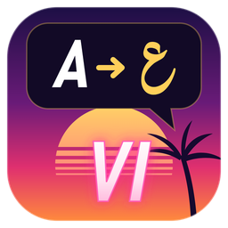

<p align="center">
  
</p>

<h1 align="center">VI Translator - Web</h1>

<p align="center">The landing page at <a href="https://vitranslator.app/">vitranslator.app</a>, in the desktop app's 33 interface languages.</p>

---

## What's here

- `src/page.html`: the page, one template for every language.
- `src/privacy.html`: the privacy policy at /privacy/ (English only; the store listings link to it). Change its date in `build.mjs` (`UPDATED`) when it changes.
- `src/strings/<code>.json`: each language's text (every key of `en.json`). `[[word]]` marks a
  highlighted word and `[A]` a controller button, as in the game.
- `src/languages.json`: the languages, in the desktop app's order. Arabic is at `/`, the others at
  `/<code>/`.
- `src/style.css`, `src/main.js`: the Vice City look and the little behaviour (the hero's live
  subtitle, the setup tabs, the language menu). No framework, no tracking, no outside requests.
- `public/`: pictures, the Changa font (SIL Open Font License) and icons.

## Build

Needs Node.js, nothing to install:

```sh
npm run build        # dist/: every language must have its text
npm run build:any    # dist/: the languages that have their text so far
```

## Deploy

The server serves `dist/` from `/var/www/vitranslator.app`, and sends `/v1/` (the API) and
`/q/health` to the backend. The nginx site is kept in the backend repo
(`deploy/nginx-vitranslator.app`).

## Screenshots

The app screenshots are of the desktop app's real interface, drawn in a browser with sample data
over a stand-in game picture (no game art).

---

<sub>VI Translator is an unofficial fan project, not affiliated with or endorsed by Rockstar Games
or Take-Two Interactive. "Grand Theft Auto" and "GTA" are trademarks of Take-Two Interactive Software, Inc.</sub>
